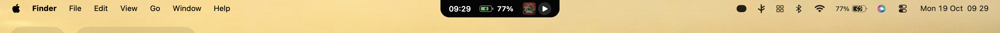
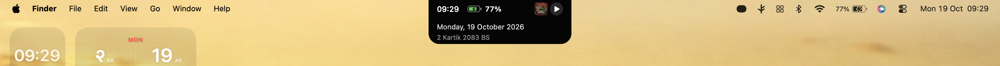
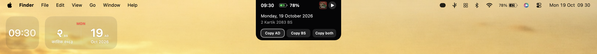
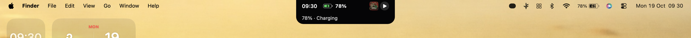
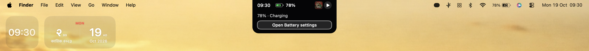
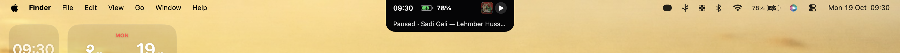
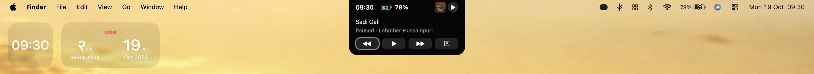

<div align="center">

# topside.

**A small, adaptive island for macOS.**

Time, battery, Nepali dates, and Spotify controls—right where you need them, without replacing the native menu bar.



*Compact by default. More detail when you hover or focus.*

[Features](#features) · [Screenshots](#screenshots) · [Build & run](#build--run) · [Install](#install-in-applications) · [Limitations](#current-status--limitations)

</div>

> [!NOTE]
> **Early prototype · v0.3.0.** Topside is a personal, local-first macOS project. It is not yet a polished public release.

## Screenshots

Topside uses progressive disclosure: the resting island stays minimal, hovering reveals contextual information, and clicking pins an interactive focused view.

### Clock and dates

| Hover | Focused |
|:---:|:---:|
|  |  |

Preview Gregorian (AD) and Bikram Sambat (BS) dates, and copy either date or both—without opening a full calendar.

### Battery and charging

| Hover | Focused |
|:---:|:---:|
|  |  |

See contextual battery and charging information, including Low Power Mode awareness.

### Spotify

| Hover | Focused |
|:---:|:---:|
|  |  |

View playback details and album artwork, with play/pause and contextual transport controls for the Spotify desktop app.

## Features

- **Adaptive island** — a quiet, compact resting state with hover previews and click-to-pin interaction.
- **Clock and battery** — 12/24-hour clock, charging feedback, battery details, and Low Power Mode awareness.
- **AD + BS dates** — Gregorian and Nepali date previews, with individual or combined copy actions; intentionally no full calendar.
- **Spotify integration** — playback state, album art, track information, and transport controls using macOS Automation permissions.
- **Contextual microinteractions** — hover dwell, leave grace, and audio-output awareness.
- **System-aware behavior** — fullscreen hiding and top-edge reveal, sleep/wake recovery, and active-display placement.
- **Native and local-first** — Swift, AppKit/SwiftUI, and IOKit; no mandatory account or cloud backend for core features.

## Requirements

- macOS **13 Ventura or later**
- Xcode Command Line Tools and a Swift **5.9+** compatible toolchain
- Spotify desktop application for music controls (optional)

## Build & run

Clone the repository:

```bash
git clone https://github.com/PrijeshBikramShahi/topside.git
cd topside
```

Run tests, package the application, and launch it:

```bash
swift test
bash build_app.sh
open build/Topside.app
```

The script compiles a release executable and creates `build/Topside.app`, using an available signing identity or ad-hoc signing if necessary. For consistent macOS Automation permissions across rebuilds, a stable signing identity is preferable.

Topside runs as a **menu-bar accessory app**, so it normally does **not** appear in the Dock. Use its menu-bar status item for settings, visibility, and quitting. Launching a second instance opens Settings.

## Install in Applications

After building, quit any running instance and copy the app bundle into your personal Applications folder (no administrator password required):

```bash
mkdir -p "$HOME/Applications"
ditto build/Topside.app "$HOME/Applications/Topside.app"
open "$HOME/Applications/Topside.app"
```

It can then be launched from Finder or Spotlight. To start Topside at login, add it under **System Settings → General → Login Items & Extensions**.

> Rebuild and recopy the app after source changes. Always quit the running installed version before replacing its bundle.

## Interactions

| Action | Behavior |
| --- | --- |
| Leave the island idle | Show the compact clock, relevant battery state, and Spotify area |
| Hover over a section | Reveal a contextual preview after a brief dwell |
| Click a section | Pin the expanded, interactive view |
| Click away or press Escape | Dismiss the pinned view |
| Use the date actions | Copy AD, BS, or both dates |
| Enter fullscreen | Hide the island; temporarily reveal it near the top edge |
| Open the menu-bar status item | Access Settings, visibility, or Quit |

Spotify control requests macOS Automation permission and does not silently launch Spotify just to check playback.

## Project layout

```text
Topside/
├── assets/
│   └── screenshots/       # Real application screenshots used in this README
├── Sources/
│   ├── Topside/            # AppKit/SwiftUI UI and macOS services
│   └── TopsideCore/        # Date, layout, battery, and interaction logic
├── Tests/
│   └── TopsideCoreTests/   # Unit tests
├── Package.swift
├── build_app.sh            # Release build, app bundle, and signing
├── THIRD_PARTY_NOTICES.md
└── README.md
```

## Current status & limitations

The development verification snapshot dated **19 October 2026** reported debug/release builds and **84 passing core tests**. That is historical test evidence, not a guarantee for every Mac.

- Spotify permissions and transport behavior still need broader manual validation.
- External-display and power-state transitions need additional on-device testing.
- A full VoiceOver audit is pending.
- BS date conversion covers **2070–2099 BS**. Dates beyond 2084 use projected calendar data and must not be relied upon for official/legal purposes.
- Topside currently provides a **virtual island**, not a custom replacement for the macOS menu bar. Expanded menu-bar functionality is a separate planned direction.

## Privacy

Core time, battery, date, and display behavior stays on-device. Spotify control uses local AppleScript Automation, subject to macOS permissions. Album artwork may load from Spotify-hosted URLs. No Topside account or mandatory subscription is required.

Logs: `~/Library/Logs/Topside.log` · Bundle ID: `com.prizesh.topside`

## Attribution & license

Read [THIRD_PARTY_NOTICES.md](THIRD_PARTY_NOTICES.md) for Bikram Sambat calendar-data attributions.

**No project-wide license has been declared.** Unless a license is added, standard copyright restrictions apply.
